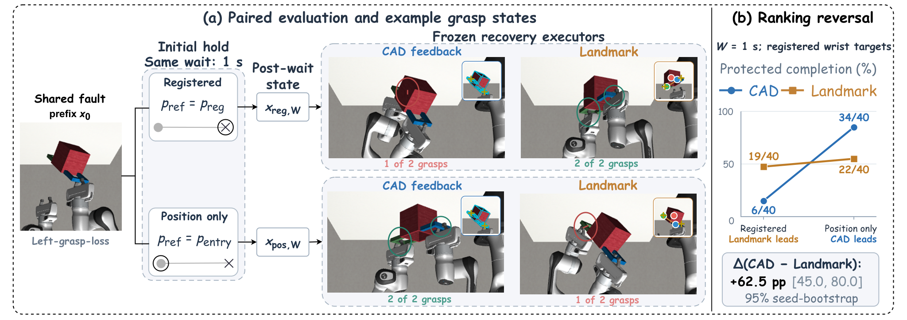
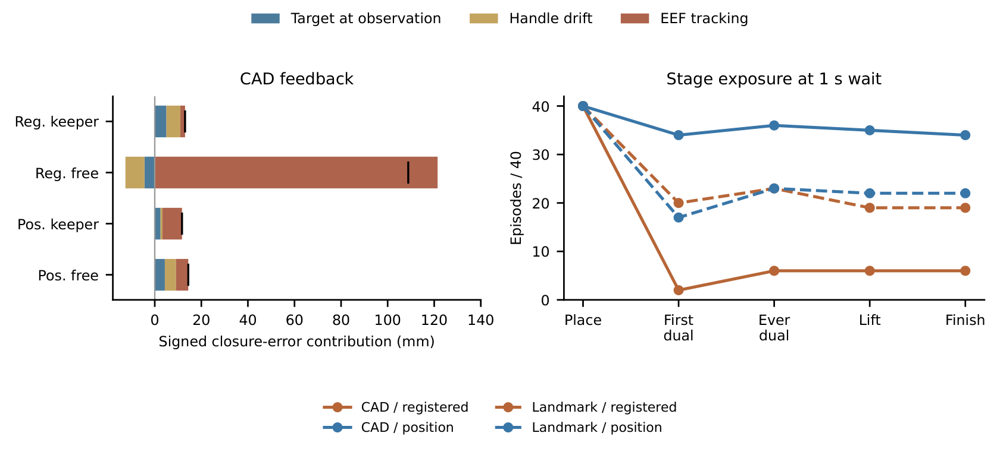
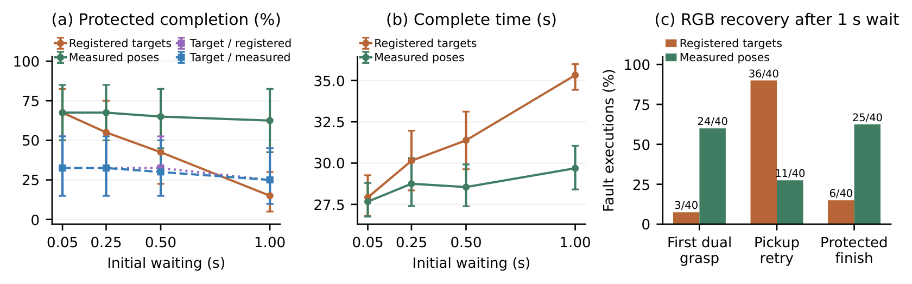

# AuditEmbodied

**English** · [简体中文](README.zh-CN.md)

**Seeing What Still Holds: How Waiting Control Changes Cooperative Recovery**

Kangjie Huang · Yucheng Xin · Xinchun Wang · Dong Liu · Yan Fan · Shuming Liu

[arXiv](https://arxiv.org/abs/2611.22368) · [Paper PDF](https://arxiv.org/pdf/2611.22368) · [Reproduction data](https://huggingface.co/datasets/Puppeter/AuditEmbodied) · [Quick start](#quick-start) · [Reproduce results](#reproduce-results) · [Citation](#citation)

AuditEmbodied evaluates recovery from bimanual manipulation faults in MuJoCo and robosuite. It varies **what the robot holds during a wait** and **how long it waits**, then compares frozen recovery methods from the same post-wait state within each condition. The trajectory audit measures task completion, protection along the path, and total recovery time, including retries and final verification.

[](docs/figures/paired-evaluation.png)

*Figure 1. After a shared grasp-loss event, the robot tracks one of two holding references for one second. Within each reference condition, both visual recovery methods start from the same post-wait state.*

## Main results

### The holding reference reverses the ranking

The cooperative-lifting study ran 960 executions on 20 initialization seeds. With the wait fixed at **1 s** and the wrist target held constant, reanchoring the position target to the measured position at wait entry reversed the ranking of CAD-feedback and landmark recovery.

| Holding reference | CAD feedback | Landmark recovery |
| --- | ---: | ---: |
| Registered position target | 6/40 | **19/40** |
| Measured position at wait entry | **34/40** | 22/40 |

Each cell reports protected completions out of 40 fault executions. A protected completion requires valid skill entry, terminal success, and compliance with the applicable trajectory constraints. The CAD-minus-landmark gap shifted by **62.5 percentage points** (95% seed-bootstrap interval 45.0–80.0).

### The gap opens during grasp formation

Both CAD conditions placed the load in 40/40 trials. Reanchoring the holding position reduced the free arm's mean tracking error at the end of the first close from **126.8 to 13.5 mm**. The first pickup established a dual grasp in 34/40 trials with position reanchoring and 2/40 with the registered target.

[](docs/figures/execution-error.png)

*Figure 2. The error decomposition separates the target residual at observation, handle drift, and end-effector tracking error. The stage counts include later retries.*

### Longer waits expose the effect of holding control

In a separate 800-execution study spanning waits of 0.05–1.00 s, CAD protected completion under registered holding fell from 27/40 to 6/40. Holding the measured position and wrist orientation kept it at 25–27/40 across the four waits. At 1 s, mean complete recovery time fell from **35.33 to 29.69 s** with measured-pose holding.

[](docs/figures/waiting-duration.png)

*Figure 3. The waiting-duration study reports protected completion, complete time, and pickup outcomes after a one-second wait. Error bars resample whole initialization seeds.*

## Quick start

Use Python 3.10 on Linux. Install OSMesa (`libosmesa6` on Debian or Ubuntu) for headless RGB rendering.

```bash
git clone https://github.com/puppet0x3f/AuditEmbodied.git
cd AuditEmbodied
python3.10 -m venv .venv
source .venv/bin/activate
python -m pip install -e . pytest
ae-smoke --render --output-dir outputs/smoke
```

### Run a recovery trial

The handover example introduces a rotation fault, waits one second with smooth position reanchoring, and writes a control trace, native contact samples, and `example-audit.json`.

```bash
python reproducibility/policy_example/handover/run_example.py \
  --out "$PWD/outputs/handover-example"
```

Use a fresh output directory for each trial. Select a holding reference with `--hold registered`, `--hold measured_position`, or `--hold smooth_position`. `--wait-seconds` accepts `0.05` and `1.0`. For a nominal cooperative-lifting rollout, run `python -m auditembodied.l4_lift --output outputs/lifting-nominal.json`.

### Run the tests

```bash
MUJOCO_GL=osmesa PYOPENGL_PLATFORM=osmesa python -m pytest -q
```

Tests that require PyTorch, NVIDIA EGL, or historical run files skip when those prerequisites are absent.

## Reproduce results

**[Download the reproduction bundle from Hugging Face (1.90 GiB ZIP)](https://huggingface.co/datasets/Puppeter/AuditEmbodied/resolve/main/AuditEmbodied-review.zip)**

The archive includes the recorded trajectories, lightweight model weights, reference tables, and NumPy evaluators. For recomputation from a Git checkout, place the archive’s `data/`, `models/`, and `reference/` directories under `reproducibility/`. The smoke test and handover example generate new trajectories from the checkout. [Reproduction guide](reproducibility/README.md)

| Path | Contents |
| --- | --- |
| [`auditembodied/`](auditembodied/) | Simulation, fault injection, recovery, training, and trajectory audits |
| [`experiments/`](experiments/) | Campaigns, diagnostics, and analysis scripts |
| [`reproducibility/`](reproducibility/) | Numerical recomputation, frozen simulator examples, and pretrained Transport adapters |
| [`tests/`](tests/) | Tests for physical control, policies, scoring, and trace replay |

The installed `ae-l0`, `ae-trajectory`, `ae-l1`, `ae-l1-calibrate`, `ae-l2`, and `ae-l2-ablation` commands list their options with `--help`. VLM experiments use a separate PyTorch, Transformers, and PEFT environment with a local checkpoint passed via `--model-path`.

## Citation

```bibtex
@misc{huang2026seeing,
  title         = {Seeing What Still Holds: How Waiting Control Changes Cooperative Recovery},
  author        = {Huang, Kangjie and Xin, Yucheng and Wang, Xinchun and Liu, Dong and Fan, Yan and Liu, Shuming},
  year          = {2026},
  eprint        = {2611.22368},
  archivePrefix = {arXiv},
  primaryClass  = {cs.AI},
  url           = {https://arxiv.org/abs/2611.22368}
}
```

The AgentChord-derived graph runtime retains its upstream attribution and Apache-2.0 terms. [AgentChord notice](third_party/AgentChord-NOTICE.md) · [License](third_party/AgentChord-LICENSE)
