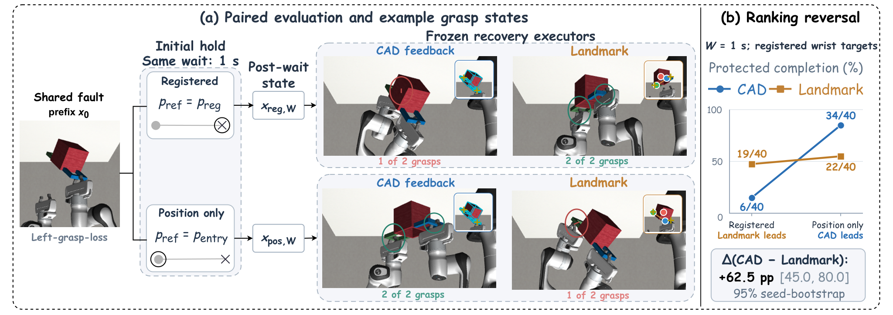
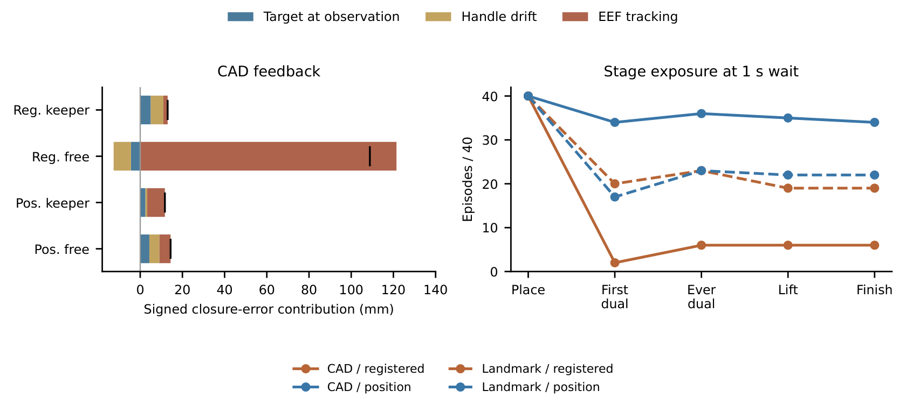
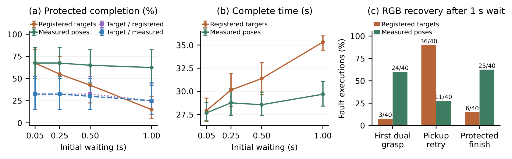

# AuditEmbodied

[English](README.md) · **简体中文**

**Seeing What Still Holds: How Waiting Control Changes Cooperative Recovery**

Kangjie Huang · Yucheng Xin · Xinchun Wang · Dong Liu · Yan Fan · Shuming Liu

[arXiv](https://arxiv.org/abs/2611.22368) · [论文 PDF](https://arxiv.org/pdf/2611.22368) · [快速开始](#快速开始) · [结果复现](#结果复现) · [引用](#引用)

AuditEmbodied 在 MuJoCo 和 robosuite 中评估双臂操作发生物理故障后的恢复。框架独立改变**等待期间的保持参考**和**等待时长**，并在每个条件下，从相同的等待后物理状态执行两种冻结的恢复方法。独立轨迹审计分别统计任务完成、全过程保护和完整恢复耗时，计入重试和最终验证。

[](docs/figures/paired-evaluation.png)

*图 1. 从同一失抓起点出发，机器人按两种保持参考分别等待一秒。每种保持条件中的两种视觉恢复方法都从同一个等待后状态开始执行。*

## 主要结果

### 保持参考改变了恢复方法的排序

双臂共同抬升实验覆盖 20 个初始化种子和 960 次执行。在**等待固定为 1 秒**且腕部目标相同的条件下，仅将位置目标重设为进入等待时的实测位置，就逆转了 CAD 反馈恢复与地标恢复的保护完成率排序。

| 保持参考 | CAD 反馈恢复 | 地标恢复 |
| --- | ---: | ---: |
| 沿用已登记的位置目标 | 6/40 | **19/40** |
| 重设为等待入口的实测位置 | **34/40** | 22/40 |

每格表示 40 次故障执行中的保护完成次数。保护完成要求技能在满足准入条件时启动、最终完成任务，并满足适用的轨迹约束。CAD 相对地标的保护完成率差值提高了 **62.5 个百分点**，以初始化种子为单位做 bootstrap 重采样得到的 95% 区间为 45.0–80.0。

### 差异在抓取形成阶段拉开

两种保持条件下，CAD 恢复都在 40/40 次试验中将负载放到桌面。重设保持位置后，自由臂首次闭爪结束时的平均跟踪误差从 **126.8 毫米降至 13.5 毫米**。首次重抓形成双臂抓取的次数由 2/40 增至 34/40。

[](docs/figures/execution-error.png)

*图 2. 闭爪误差分解为观测时的目标偏差、把手漂移和末端跟踪误差。阶段计数也覆盖后续重试。*

### 延长等待凸显保持控制的作用

独立的 800 次执行覆盖 0.05–1.00 秒的四档等待。沿用已登记的位姿目标时，CAD 的保护完成从 27/40 降至 6/40。保持实测位置和腕部姿态时，四档结果均在 25–27/40 范围内。在 1 秒等待下，实测位姿保持将平均完整恢复耗时从 **35.33 秒缩短至 29.69 秒**。

[](docs/figures/waiting-duration.png)

*图 3. 等待时长实验报告保护完成率、完整耗时以及一秒等待后的重抓结果。误差条按整个初始化种子重采样。*

## 快速开始

使用 Linux 和 Python 3.10。无窗口 RGB 渲染需要 OSMesa，Debian 或 Ubuntu 上可安装 `libosmesa6`。

```bash
git clone https://github.com/puppet0x3f/AuditEmbodied.git
cd AuditEmbodied
python3.10 -m venv .venv
source .venv/bin/activate
python -m pip install -e . pytest
ae-smoke --render --output-dir outputs/smoke
```

### 运行一次故障恢复

该双臂交接示例施加旋转故障，在一秒等待中平滑重设保持位置，并生成控制轨迹、原生接触样本和 `example-audit.json`。

```bash
python reproducibility/policy_example/handover/run_example.py \
  --out "$PWD/outputs/handover-example"
```

每次试验使用新的输出目录。`--hold registered`、`--hold measured_position` 和 `--hold smooth_position` 分别对应沿用已登记目标、保持实测位置和平滑重设保持位置。`--wait-seconds` 接受 `0.05` 或 `1.0`。运行 `python -m auditembodied.l4_lift --output outputs/lifting-nominal.json` 可执行一次无故障共同抬升。

### 运行测试

```bash
MUJOCO_GL=osmesa PYOPENGL_PLATFORM=osmesa python -m pytest -q
```

依赖 PyTorch、NVIDIA EGL 或历史运行文件的测试会在缺少对应条件时跳过。

## 结果复现

烟测和交接示例可以从当前仓库生成新轨迹。复算论文表格需要对应的轨迹、模型文件和参考表格，分别放在 `reproducibility/data/`、`reproducibility/models/` 和 `reproducibility/reference/`。复现指南介绍输入文件、NumPy 复算入口和仿真示例。[复现指南](reproducibility/README.md)

| 路径 | 内容 |
| --- | --- |
| [`auditembodied/`](auditembodied/) | 仿真、故障注入、恢复控制、训练和轨迹审计 |
| [`experiments/`](experiments/) | 实验运行、诊断与分析脚本 |
| [`reproducibility/`](reproducibility/) | 数值复算、冻结仿真示例和预训练 Transport 策略适配器 |
| [`tests/`](tests/) | 物理控制、策略、评分和轨迹回放测试 |

`ae-l0`、`ae-trajectory`、`ae-l1`、`ae-l1-calibrate`、`ae-l2` 和 `ae-l2-ablation` 均可通过 `--help` 查看参数。VLM 实验使用独立的 PyTorch、Transformers 和 PEFT 环境，通过 `--model-path` 指定本地权重。

## 引用

```bibtex
@misc{huang2026seeing,
  title         = {Seeing What Still Holds: How Waiting Control Changes Cooperative Recovery},
  author        = {Huang, Kangjie and Xin, Yucheng and Wang, Xinchun and Liu, Dong and Fan, Yan and Liu, Shuming},
  year          = {2026},
  eprint        = {2611.22368},
  archivePrefix = {arXiv},
  primaryClass  = {cs.AI},
  url           = {https://arxiv.org/abs/2611.22368}
}
```

基于 AgentChord 的图执行组件保留上游署名和 Apache-2.0 条款。[AgentChord 署名说明](third_party/AgentChord-NOTICE.md) · [许可证](third_party/AgentChord-LICENSE)
